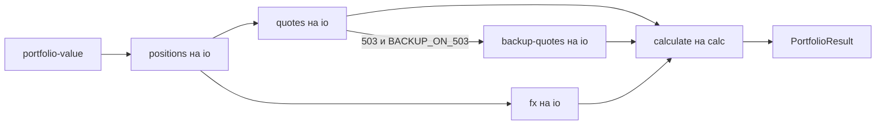
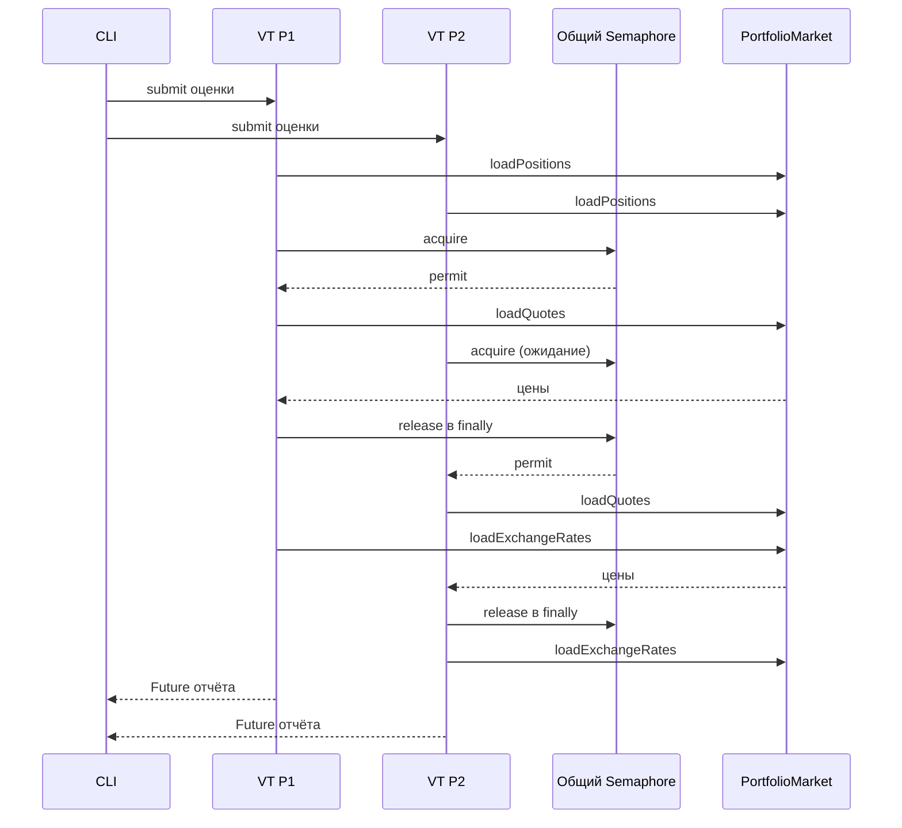

# Семинар 12 - порядок показа кода

Готовый код открываем в `advanced`, JDK 25. Маршрут на 90 минут оставляет больше теории для чтения после занятия; на 120 минут добавляем сетевой блок и подробную диагностику виртуальных потоков.

| Время: 90 / 120 мин | Тема презентации | Что открыть | На что обратить внимание |
|---|---|---|---|
| 0–15 / 0–15 | Future и CompletableFuture | `PortfolioServiceV1.evaluatePortfolios`, `PortfolioServiceV2.evaluateAsync`, `loadQuotesAsync` | После позиций цены и курсы независимы. У V1 координатор ждёт `get`; у V2 зависимости выражены через `thenCompose` и `thenCombineAsync`. Сеть на `io`, расчёт на `calc`. |
| - / 15–30 | C10K, reactor, блокирующий ввод-вывод | `PortfolioHttpClient.get`, затем существующий `client.impl.reactor.EventLoop.run` | Блокирующий API описывает ожидание ответа, reactor явно управляет готовностью сокетов. Виртуальные потоки позволяют сохранить последовательный код клиента. |
| 15–30 / 30–60 | Виртуальный поток и carrier thread | `OneCarrierNetworkDemo.main`, `readResponse`; затем `PortfolioFailureDemoTest` | Запустить два запроса при одном carrier. P2 доходит до сервера до выдачи ответа P1. Ожидание сокета освобождает carrier; это не ускоряет расчёт. В диагностике различать ошибку одной ветви и двух ветвей. |
| 30–60 / 60–90 | Пакет задач и ограничение нагрузки | `PortfolioServiceV3.evaluatePortfolios`, `evaluateOne`; `AsyncUtils.collectInOrder` | Один виртуальный поток на портфель, один общий Semaphore на сервис. Permit охватывает запрос котировок и освобождается в `finally`. Результаты сохраняют порядок ввода независимо от порядка завершения. |
| 60–90 / 90–120 | Практика | `practice.TaskStarters` или `practice.DefectStarters`, `PracticeStarterChecks` | Одна карточка на человека: 20 минут реализации и 10 минут обсуждения. Связать обнаруженный дефект с зависимостями, ресурсами или атомарной публикацией. |

## Перед показом

Запустить `PortfolioMock` (тестовый main, порт 1081). Команды и classpath описаны в [COMMANDS](../../COMMANDS.md#семинар-12-оценка-портфеля).

```text
portfolio-value P1 P2 --engine FUTURE --trace
portfolio-value P1 P2 --engine CF --trace
portfolio-value P1 P2 --engine VT --quote-limit 1 --trace
```

Это аргументы корневого `academy.backend.market_pulse.Main`. Для каждого портфеля ожидается `2100 RUB`. Порядок строк trace может меняться; итоговые строки идут в порядке ввода. В CLI default engine - `VT`, валюта - `RUB`.

Для отказа перезапустить mock с `--quotes-503`: без дополнительной политики получим ошибку, с `--quote-failure BACKUP_ON_503` - `2460 RUB`. `PortfolioServiceV2.loadQuotesAsync` использует `exceptionallyCompose`, чтобы дождаться резерва. При двух отказах `MarketDataException` хранит одну причину в `cause`, другую в `suppressed`; `thenCombine` сам такую политику диагностики не задаёт.

## Граф зависимостей одного портфеля



Это граф V2: ребро `quotes → calculate` означает успешный результат основной либо резервной ветви. `thenCompose` связывает загрузку позиций с новым асинхронным графом; `thenCombineAsync` соединяет данные двух ветвей. `PortfolioValuation` содержит общий расчёт для всех трёх реализаций.

## Виртуальные потоки и общая квота 1



Диаграмма показывает один допустимый порядок. Permit ограничивает обращения к поставщику, а не количество виртуальных потоков. Порядок завершения отчётов может отличаться. `close` дожидается задач executor; прерывание ожидания передаётся через `InterruptedException`, а блокирующий HTTP-клиент ограничен таймаутами и не обещает немедленной отмены запроса.

## Навигация

- [Алгоритмы оценки](../../../src/main/java/academy/backend/market_pulse/portfolio)
- [DTO и результаты](../../../src/main/java/academy/backend/market_pulse/dto/portfolio)
- [Тесты, демо и практика](../../../src/test/java/academy/backend/market_pulse/portfolio)
- [Два запроса на одном carrier thread](Демо%20—%20виртуальные%20потоки.md)
- [Выбор карточки](Обзор%20практики.md), [доработки](Практика%20—%20доработки.md), [исправление ошибок](Практика%20—%20исправление%20ошибок.md)

`TaskReference` и `DefectReference` - готовые решения для преподавателя. Они проверяются обычным набором тестов. `PracticeStarterChecks` запускается явно и до реализации TODO должен завершаться ошибкой.
